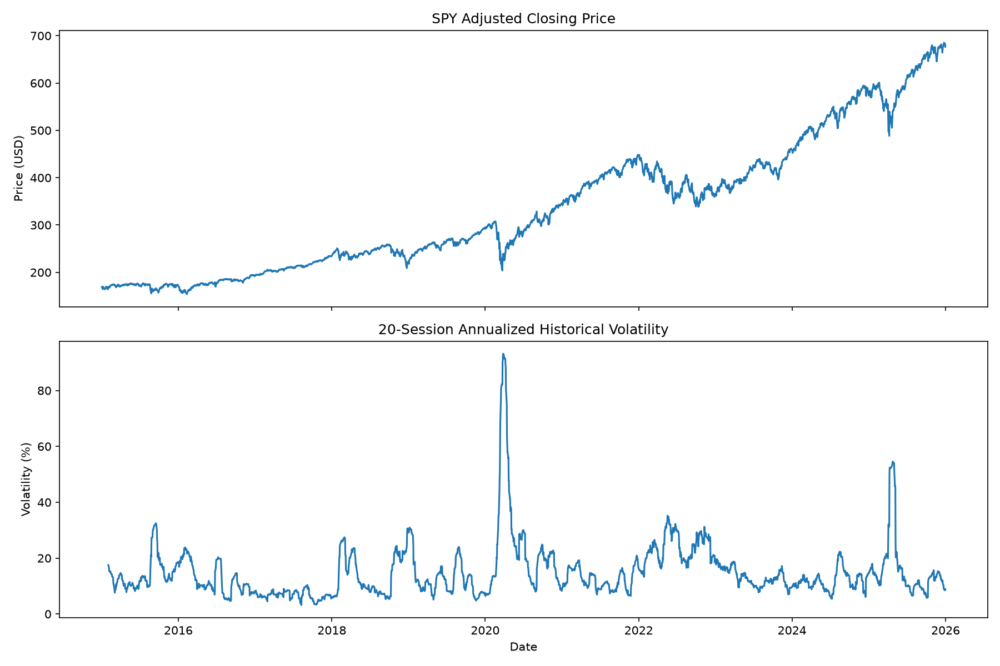
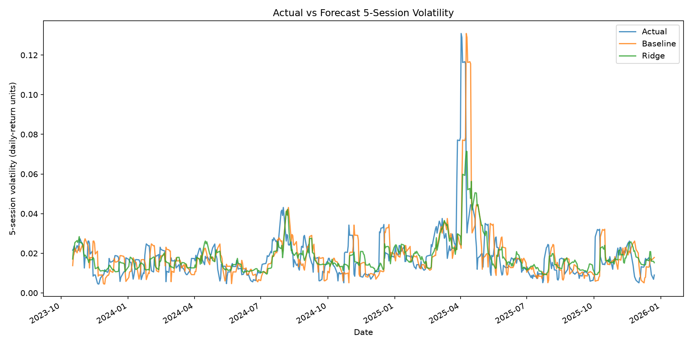

# Prognozowanie zmienności SPY

W tym projekcie sprawdzam, czy regresja Ridge potrafi przewidywać krótkoterminową zmienność rynku lepiej niż prosta metoda oparta na ostatnich sesjach.

Korzystam z danych historycznych ETF-u SPY za lata 2015–2025. Zamiast przewidywać, czy cena wzrośnie lub spadnie, próbuję oszacować, jak duże mogą być ruchy cen w ciągu następnych pięciu sesji.

## Wyniki

Na początku porównałem model z prostą metodą bazową, która wykorzystuje stopy zwrotu z pięciu poprzednich sesji.

| Metoda         |      MAE |
| -------------- | -------: |
| Metoda bazowa  | 0,008005 |
| Regresja Ridge | 0,006306 |

Na głównym zbiorze testowym błąd modelu Ridge był o **21,22% niższy** niż błąd metody bazowej.

Sprawdziłem też model na czterech kolejnych okresach historycznych. Chciałem zobaczyć, czy przewaga utrzyma się przy innym podziale danych.

| Okres testowy | MAE metody bazowej | MAE Ridge |
| ------------- | -----------------: | --------: |
| 2021–2022     |           0,008768 |  0,007718 |
| 2022–2023     |           0,007640 |  0,005534 |
| 2023–2024     |           0,006215 |  0,004781 |
| 2024–2025     |           0,009792 |  0,007833 |

Ridge uzyskał niższy błąd we wszystkich czterech okresach. Średnia poprawa wyniosła około 20,65%.

To dobry rezultat, ale nie oznacza jeszcze, że model będzie działał równie dobrze na innych instrumentach lub na przyszłych danych.

## Jak to działa?

Najpierw pobieram dane cenowe SPY i obliczam dzienne stopy zwrotu. Na ich podstawie tworzę kilka cech opisujących ostatnie zachowanie rynku:

- zmienność z ostatnich 5 i 20 sesji,
- średnią stopę zwrotu z ostatnich 5 i 20 sesji,
- średnią wartość bezwzględnej stopy zwrotu z ostatnich 5 sesji.

Następnie model próbuje przewidzieć zmienność z kolejnych pięciu sesji. Do treningu wykorzystuję regresję Ridge ze skalowaniem cech.

Podział danych jest chronologiczny — model uczy się na wcześniejszych obserwacjach, a wyniki sprawdzam na późniejszych. Między treningiem a testem zostawiam również pięć obserwacji odstępu, ponieważ przewidywane okresy obejmują kolejne sesje.

Do porównania wykorzystuję MAE, czyli średni błąd bezwzględny. Niższa wartość oznacza dokładniejsze prognozy.

## Wykresy

**Cena SPY i zmienność historyczna**



**Wartości rzeczywiste i prognozowane**



## Struktura projektu

```text
ml-volatility-forecasting/
├── data/
│   ├── raw/
│   └── processed/
├── reports/
│   ├── figures/
│   ├── research_report.md
│   ├── rolling_evaluation.csv
│   └── test_predictions.csv
├── src/
│   ├── download_data.py
│   ├── explore_data.py
│   ├── analyze_returns.py
│   ├── prepare_features.py
│   ├── train_model.py
│   ├── evaluate_results.py
│   ├── rolling_evaluation.py
│   └── audit_experiment.py
└── requirements.txt
```

Najważniejsze skrypty odpowiadają za pobieranie danych, przygotowanie cech, trening modelu i ocenę wyników. Dodałem również osobny skrypt sprawdzający obliczenia celu i metody bazowej. Dokładniejszy opis eksperymentu znajduje się w `reports/research_report.md`.

## Uruchomienie

Projekt przygotowałem w Pythonie. Po zainstalowaniu zależności skrypty można uruchomić z głównego katalogu projektu.

```bash
pip install -r requirements.txt
python src/download_data.py
python src/prepare_features.py
python src/train_model.py
python src/evaluate_results.py
python src/rolling_evaluation.py
python src/audit_experiment.py
```

Dodatkowe skrypty do eksploracji danych i analizy stóp zwrotu to `src/explore_data.py` oraz `src/analyze_returns.py`.

## Co dalej?

Na razie testuję tylko SPY i jeden typ modelu. Następnym krokiem byłoby porównanie Ridge z innymi metodami oraz sprawdzenie, czy podobne wyniki pojawiają się na innych instrumentach.

Nie testowałem jeszcze strategii inwestycyjnej. Sam fakt, że model lepiej przewiduje zmienność, nie oznacza automatycznie, że można na jego podstawie zarabiać.
